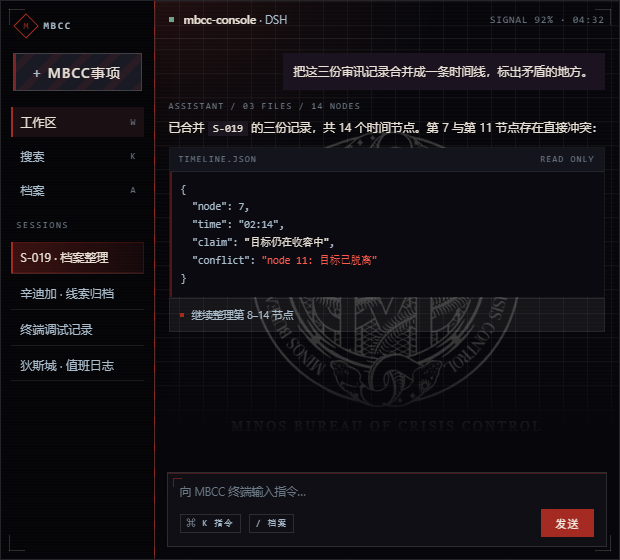
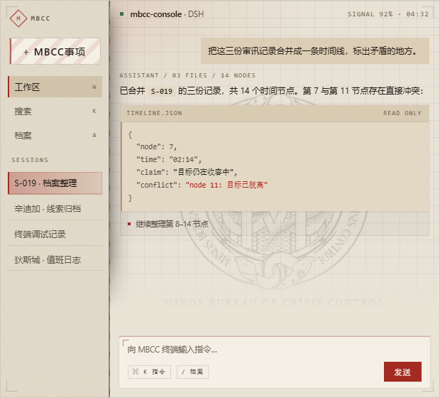
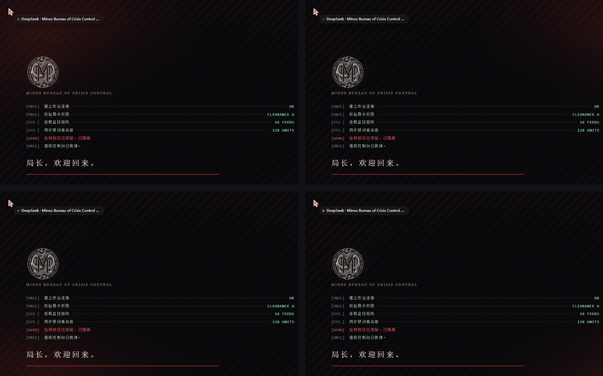
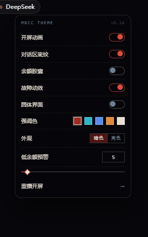
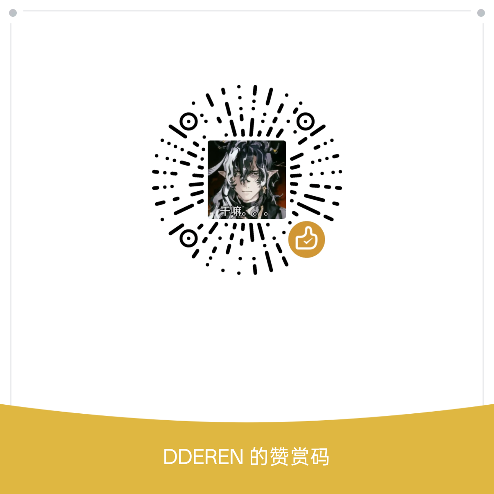

# MBCC Console · 无期迷途风格 DSH 主题

把 DSH（DeepSeek Harness）桌面端做成 **Minos Bureau of Crisis Control** 的档案控制台：
近黑底、纸色字、档案红色，直角 + 发丝线 + 切角 + 警戒带。

> 同人二创，**仅供学习交流，不作商用**。界面中使用的游戏徽标、字体与参考截图的版权归各自权利人所有。




## 特性

- **121 个 token**，深/浅两套成对；零圆角、1px 描边，红色只做信号（≤ 8%）；
- **终端自检开屏**：逐行打印 → 红线 → 淡出，背景为警示斜纹 + 每次随机强调色光；
- **侧栏档案索引**：发丝分隔、暗红选中条、切角档案夹图标、`MBCC AI TERMINAL` 锁版；
- **标题栏余额胶囊**：灵动岛式，可点击展开可用/赠送/币种/时间，低于阈值红色慢闪；
- **主题设置面板**：点左上角徽标呼出——开屏 / 底纹 / 胶囊 / 故障动效 / 圆体界面 / 强调色 / 暗亮外观 / 低余额阈值；
- **强调色**：红、青、蓝、橙、白（浅色下白转黑），通过 token 层切换，描边与红光一起跟随；
- **四个动效**：发送扫描线、新消息落位、会话红规生长、窗口失焦待机；
- **彩蛋**：开屏出现，请各位局长自行探索




## 安装

```powershell
# 1) 复制主题包到 DSH profile
powershell -ExecutionPolicy Bypass -File .\mbcc-console-theme\install.ps1

# 2) 重启 DSH Desktop
```

脚本会把包放到 `%USERPROFILE%\.dsh\profiles\desktop\node_modules\dsh-theme-mbcc-console`，
并在 `cordis.patch.yml` 里追加注册项。卸载用 `uninstall.ps1`。

完整用法、排错与手动安装步骤见 **[使用说明.md](使用说明.md)**。

## 仓库结构

| 路径 | 说明 |
| --- | --- |
| `mbcc-console-theme/` | DSH 主题包（源代码、素材、预览页、安装脚本） |
| `使用说明.md` | 功能、安装、卸载、排错 |
| `无期迷途美术风格复刻指南.md` | 风格系统的研究文档（色彩 / UI / 动效 / 场景 / 验收清单） |
| `tokens/` | 机器可读 token 与 CSS 变量 |
| `style-demo.html` | 可直接双击打开的风格样张 |
| `refs/` | 效果截图与研究素材 |

主题目录里还有 10 个 `*.preview.html`，可以离线打开看各模块状态，不需要安装 DSH。

## 设计公式

> **冷形式 × 热内容**：档案、编号、细线、等宽数字做骨架；血色、皮肤、霓虹、颗粒做内容。
> 界面骨架采用黑白灰，红色只属于状态与事件，面积 ≤ 8%。

1. 圆角 ≤ 2px，描边永远 1px，角度只用 0°/45°/90°；
2. 红色像素 ≤ 8%，背景是黑 / 冷蓝灰；
3. 中央 60% 留给内容，UI 全部贴边；
4. 结构化动效 90–240ms，氛围动效 3.6–12s，禁止弹跳；
5. 场景光比 ≥ 1:8，大负空间，单一主光 + 前景剪影。

## 版权与授权

- 《无期迷途》的角色、徽标、UI 与截图的版权归上海自意网络所有；本仓库为同人二创，仅用于学习交流；
- `mbcc-console-theme/assets/fonts/zihun-round.ttf`（字魂创中圆）标注「商用需授权」，仅随仓库提供用于个人预览；
- 如需二次分发或商用，请自行替换徽标与字体，并取得相应授权。

## 支持作者给大肥鱼买大米

如果这个主题帮到了你，可以给大肥鱼买点大米。**完全自愿，不影响任何功能**；扫码前请自行确认收款方。

| 支付宝 | 微信赞赏 |
| :---: | :---: |
|  |  |


