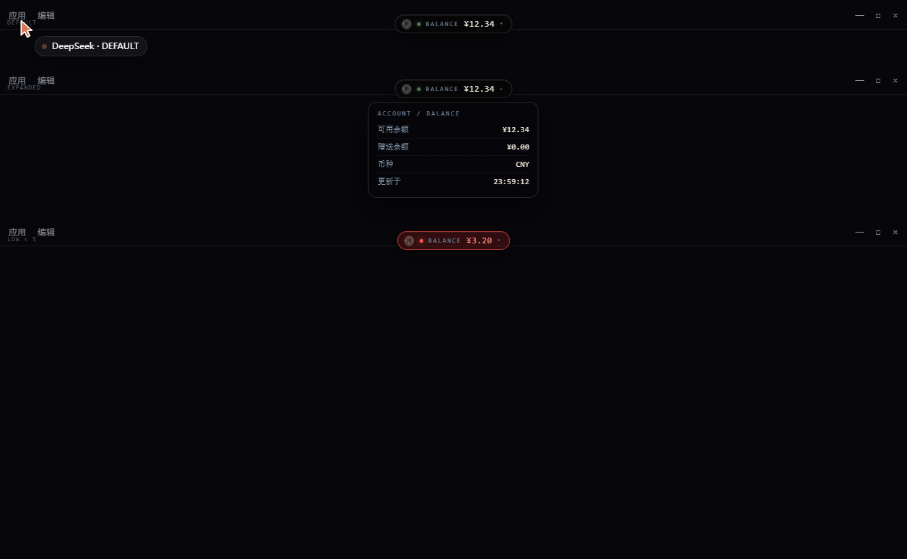

# MBCC 控制台主题 · 使用说明

一个给 DSH（DeepSeek Harness）桌面端用的主题包：把界面做成「Minos Bureau of Crisis Control」的
档案控制台——近黑底、纸色字、档案红只做信号，直角、发丝线、切角与警戒带。

- 主题包：`mbcc-console-theme/`（v0.48）
- 设计依据：`无期迷途美术风格复刻指南.md`
- 适用：DSH Desktop（Windows），Electron 渲染层


---

## 一、功能

### 1. 配色与形态

- 两套色板：深色（近黑 `#07070B` + 纸色 `#E8E0D4`）与浅色（纸底 + 墨色）；
- 121 个 token 全部成对给出，覆盖背景、文字、边框、按钮、状态、焦点环等；
- 全局零圆角、1px 描边；红色只用于主操作、焦点、选中与危险，占比 ≤ 8%；
- 侧栏工作区为「档案索引」式行列表：发丝分隔线、暗红选中条、分组粗线；
- 对话区：24px 网格 + 居中机构水印 + 扫描线，左上角一层强调色暗光。

### 2. 开屏动画

- 终端自检风格：逐行打印 → 状态闪烁 → 红线绘制 → 3 秒后淡出；
- 背景为 45° 警示斜纹，**每次启动随机一个角**亮起强调色红光；
- 点击任意处或按键可跳过；
- 极低概率彩蛋：某一行文字变乱码，且「局长」→ `shp-13`、「欢迎」→ `？？`。


### 3. 侧栏品牌与按钮

- 左上角为徽标 + `MBCC AI TERMINAL`（字号 15px，带 3px 光学补偿）；
- 新会话按钮文案改为「MBCC事项」，警戒线斜纹 + 左侧红规；
- 按钮悬停时斜纹滑动、高光扫过、红边发光；
- 图标为切角括号准星，颜色跟随文字与强调色。

### 4. 余额胶囊

- 标题栏正中一颗灵动岛式胶囊：徽标 + 状态点 + `BALANCE` + 金额；
- 数据来自与「设置 → 账号」相同的接口（`remote.account.getBalance`），60 秒轮询；
- 点击展开：可用余额 / 赠送余额 / 币种 / 更新时间；
- 低于阈值时整颗变红慢闪（危险语义，不跟强调色变）。



### 5. 主题设置面板

点击左上角徽标呼出：

| 项 | 说明 |
| --- | --- |
| 开屏动画 | 开/关；「重播开屏」可手动再看一次 |
| 对话区底纹 | 网格 + 水印的总开关 |
| 余额胶囊 | 显示 / 隐藏标题栏胶囊 |
| 故障动效 | 侧栏随机错层切片、标题入场、金额色散的总开关 |
| 圆体界面 | 在系统字体与内置「字魂创中圆」之间切换（标题不受影响） |
| 强调色 | 红 / 青 / 蓝 / 橙 / 白（浅色主题下白色自动变黑） |
| 外观 | 暗色 / 亮色 分段选择，走 DSH 官方外观接口 |
| 低余额预警 | 1–100 滑块 + 数字输入，改动即时生效 |
| 重播开屏 | 立即重放一次开屏 |


设置保存在 `localStorage`；切换主题/强调色时有 200ms 柔光过渡。

### 6. 动效

| 位置 | 效果 | 时长 |
| --- | --- | --- |
| 发送消息 | 输入框顶部一条强调色线扫过 | 280ms |
| 新消息 | 轻微上浮 + 左侧红规画出 | 280ms |
| 选中会话 | 左侧 2px 红规自上而下生长 | 220ms |
| 窗口失焦 | 侧栏品牌降亮 + 左下角 `PAUSED` | 常驻 |
| 侧栏故障 | 2–3 条黑白灰错层切片，随机位置 | 300ms，低频 |
| 余额刷新 | 数字红/青错位 | 620ms |

所有动效只动 `opacity / transform / clip-path`；系统开启「减少动态效果」时自动关闭。

---

## 二、安装

### 前置

- Windows 上的 DSH Desktop；
- 已至少启动过一次 DSH（确保 `%USERPROFILE%\.dsh\profiles\desktop` 存在）。

### 方式 A：脚本安装（推荐）

把 `mbcc-console-theme` 文件夹放到任意位置，在 PowerShell 里执行：

```powershell
powershell -ExecutionPolicy Bypass -File .\mbcc-console-theme\install.ps1
```

脚本会：

1. 把包复制到 `%USERPROFILE%\.dsh\profiles\desktop\node_modules\dsh-theme-mbcc-console`；
2. 在 `cordis.patch.yml` 末尾追加一行主题注册（已有则跳过）。

指定其它 profile：

```powershell
powershell -ExecutionPolicy Bypass -File .\install.ps1 -ProfileDir "D:\other\profile"
```

### 方式 B：手动安装

1. 复制 `mbcc-console-theme` 到
   `C:\Users\<你>\.dsh\profiles\desktop\node_modules\dsh-theme-mbcc-console`；
2. 打开 `C:\Users\<你>\.dsh\profiles\desktop\cordis.patch.yml`，在末尾追加：

   ```yaml
   - insert:
       - id: mbcc-console
         name: 'dsh-theme-mbcc-console'
   ```

3. 重启 DSH。

### 启用

重启后在「设置 → 外观」里应能看到该主题；若没有，检查 `cordis.patch.yml` 是否追加成功、
以及控制台是否有 `theme "..." is not registered` 之类的报错。

> 主题生效需要重启应用，**热更新不覆盖主题**。

---

## 三、卸载 / 更新

**卸载**：

```powershell
powershell -ExecutionPolicy Bypass -File .\mbcc-console-theme\uninstall.ps1
```

会删除 profile 里的包并移除 patch 行（重启后恢复默认外观）。

**更新**：用新版本覆盖 `mbcc-console-theme` 后重新运行 `install.ps1`，再重启。

---

## 四、已知限制

1. **每次改主题都要重启**：DSH 的主题注册只在启动时加载；
2. **设置存在 localStorage**：Web GUI 端口变化会换 origin，设置可能回到默认；桌面端不受影响；
3. **余额胶囊依赖登录**：未登录或接口不可用时显示 `—`，不会编造数字；
4. **字体授权**：内置「字魂创中圆」（`assets/fonts/zihun-round.ttf`）文件名标注「商用需授权」，
   仅限本机个人使用；对外分发前请先取得授权，或删掉字体、只保留 `local()` 回退；
5. 浅色主题下部分红色描边会略深，这是按对比度算过的结果。

---

## 五、目录结构

```
mbcc-console-theme/
├─ index.js              # 宿主侧插件入口（注册 name/apply）
├─ client.js             # 浏览器侧：token + CSS + 开屏 + 胶囊 + 设置 + 动效
├─ package.json          # 0.48.0
├─ cordis.patch.yml      # 注册片段
├─ install.ps1 / uninstall.ps1
├─ verify.js             # 契约 / 幂等 / 卸载检查
├─ audit-contrast.js     # 34 组 WCAG 对比度检查
├─ assets/               # 徽标、水印、字体
├─ *.preview.html        # 各模块静态预览（可离线打开）
└─ build-*.js            # 从 client.js 生成预览的脚本
```

预览文件都可以直接用浏览器打开（`font-preview.html`、`menu-preview.html`、
`motion-preview.html`、`boot-preview.html` 等），不需要装 DSH。

---

## 六、排错

| 现象 | 处理 |
| --- | --- |
| 重启后外观没变 | 确认 `cordis.patch.yml` 里有 `mbcc-console` 行；看启动日志有无主题报错 |
| 余额胶囊一直是 `—` | 未登录账号，或接口版本字段不匹配；先确认「设置 → 账号」能显示余额 |
| 设置改了没保存 | localStorage 被禁用或换了端口；桌面端重启后仍应保留 |
| 字体没变 | 设置里「圆体界面」默认关闭；打开后若仍无变化，检查 client.js 是否被截断 |
| 界面变慢 | 关掉「故障动效」与「圆体界面」；5MB 字体只在启用时解码 |

---

## 七、版本

当前 **v0.48**（BUILD `mbcc-console/48`）。完整变更记录见 `mbcc-console-theme/README.md`。
